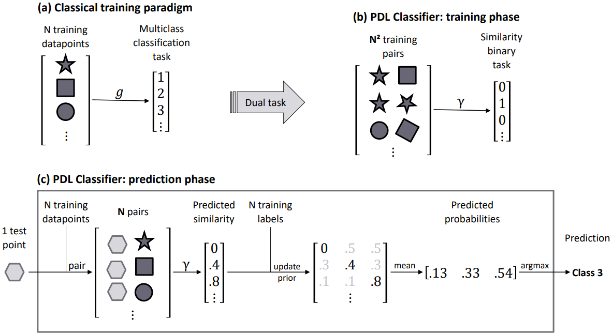
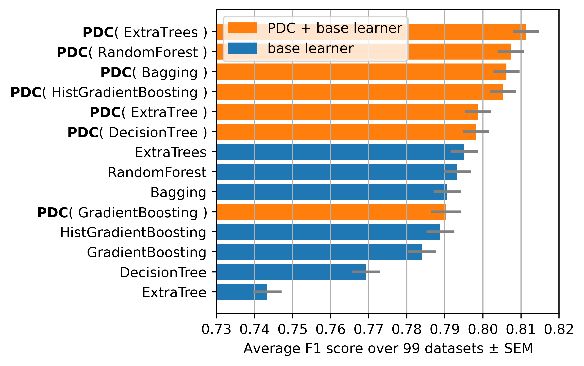
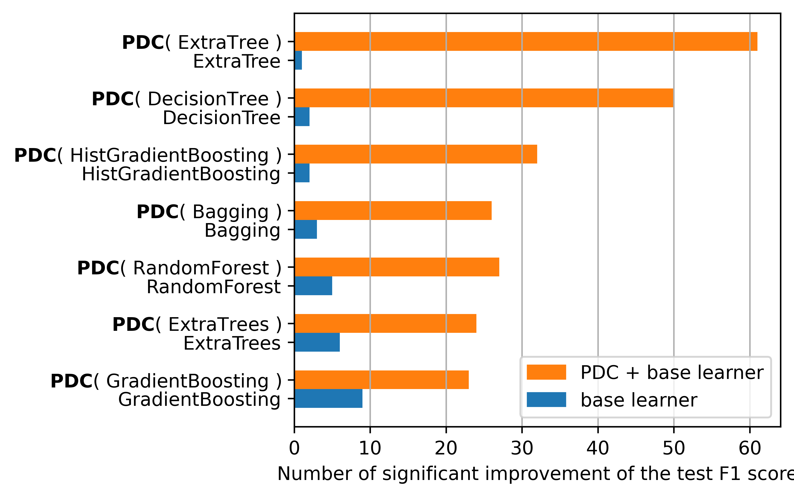
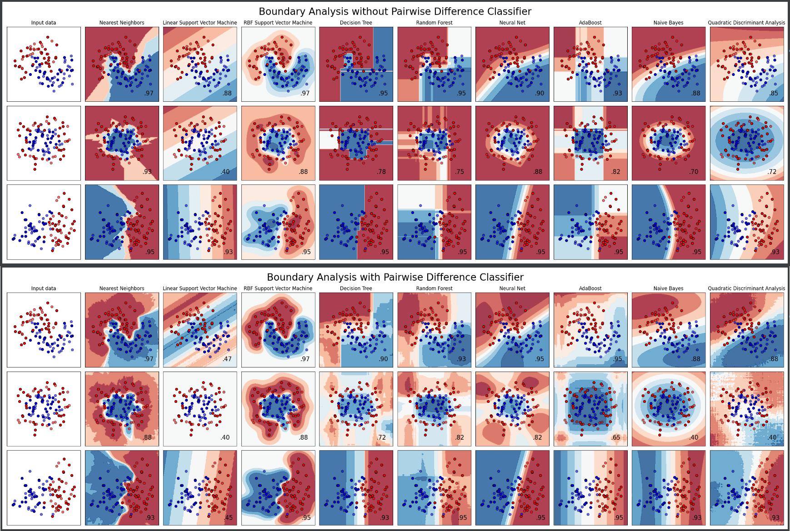

<h1 align="center">Pairwise Difference Learning (pdll)</h1>

<p align="center">
  <b>A scikit-learn meta-estimator that trains your tree model on <i>pairs of points</i>, for small tabular datasets.</b>
</p>

<p align="center">
  <a href="https://pypi.org/project/pdll/"></a>
  <a href="https://pypi.org/project/pdll/"></a>
  <a href="https://github.com/Karim-53/pdll/actions/workflows/ci.yml"></a>
  <a href="https://github.com/Karim-53/pdll/actions/workflows/e2e.yml"></a>
  <a href="https://pepy.tech/project/pdll"></a>
  <a href="https://github.com/Karim-53/pdll/blob/main/LICENSE"></a>
  <a href="https://doi.org/10.1007/978-3-031-78980-9_18"></a>
</p>

**Pairwise Difference Learning (PDL)** turns a multiclass problem into a binary one. Instead of asking *"what class is this point?"*, the base model learns *"are these two points of the same class?"* from every pair of training points. A new point is then compared with the training points (the *anchors*), whose labels are known. With n training rows the model sees n² examples, which helps most when data is scarce.

`pdll` wraps any scikit-learn classifier (or regressor) and keeps the usual `fit` / `predict` / `predict_proba` / `score` API. It implements [Belaid, Rabus & Hüllermeier, *Pairwise Difference Learning for Classification*, Discovery Science 2024](https://doi.org/10.1007/978-3-031-78980-9_18) ([arXiv](https://arxiv.org/abs/2406.20031)).

### ✨ Highlights
- 🔌 **Drop-in**: works in `Pipeline`, `GridSearchCV` and `cross_val_score`, passes scikit-learn's own estimator checks, and never modifies the estimator you pass in.
- 🧾 **Raw DataFrames welcome** (pandas, polars or pyarrow): string, category, bool and nullable columns are encoded for you; missing values go straight to base learners that support them (e.g. HistGradientBoosting).
- 📈 **More accurate tree models**: in the paper, PDL improves tree-based learners on 99 OpenML datasets (macro-F1). In the [end-to-end suite](#evaluation) that CI runs on every change, it wins 18 of 30 dataset/learner pairs (11 losses) and raises mean macro-F1 from 0.873 to 0.894.
- 🧪 **Validated on 131 real datasets** ([results](benchmark/real_world/README.md)): raw Kaggle, OpenML, scikit-learn and Zindi data, with no crashes and at most 2.6 GB of memory.
- 🛡️ **Tested**: Python 3.9–3.14, numpy ≥ 1.23, pandas ≥ 1.5, scikit-learn ≥ 1.2 (Kaggle and Colab stacks included), Linux, Windows and macOS.

[](https://youtu.be/5Yl6yFiNK3U?si=SXuRrO3mibD188xF "Learn more about PDL on youtube")

### 📖 Contents
[Installation](#installation) · [Usage](#usage) · [When to use it](#when-to-use-it) · [How does it work?](#how-does-it-work) · [Evaluation](#evaluation) · [Citation](#citation)

## Installation
```shell
pip install -U pdll
```

## Usage
```python
from sklearn.datasets import load_wine
from sklearn.ensemble import RandomForestClassifier
from sklearn.model_selection import cross_val_score

from pdll import PairwiseDifferenceClassifier

X, y = load_wine(return_X_y=True)

rf = RandomForestClassifier(class_weight="balanced", random_state=0)
pdc = PairwiseDifferenceClassifier(estimator=rf)

print("RandomForest     :", cross_val_score(rf, X, y, cv=5).mean())
print("PDC(RandomForest):", cross_val_score(pdc, X, y, cv=5).mean())

pdc.fit(X, y)
pdc.predict(X[:3])            # array of labels, like any scikit-learn classifier
pdc.predict_proba(X[:3])      # ndarray (n_samples, n_classes), columns follow pdc.classes_
```

**Raw DataFrames** (strings, categories, missing values) work directly:
```python
from sklearn.datasets import fetch_openml
from sklearn.ensemble import HistGradientBoostingClassifier

X, y = fetch_openml("titanic", version=1, as_frame=True, return_X_y=True)
X = X[["pclass", "sex", "age", "sibsp", "parch", "fare", "embarked"]]   # drop identifiers such as name or ticket

pdc = PairwiseDifferenceClassifier(HistGradientBoostingClassifier(class_weight="balanced"))
pdc.fit(X[:600], y[:600]).score(X[600:900], y[600:900])
```

**Regression** uses the same idea: the base model learns the target *difference* between two points.
```python
from pdll import PairwiseDifferenceRegressor
from sklearn.tree import DecisionTreeRegressor

pdr = PairwiseDifferenceRegressor(DecisionTreeRegressor()).fit(X_train, y_train)
pdr.learn_anchor_weights(X_val, y_val, method="L2")   # optional: learn a weight per anchor
```

More in [`examples/`](examples/): uncertainty from the per-anchor posteriors (`predict_proba_samples`), weighted regression, and more.

### Main parameters
| Parameter | Default | Meaning |
|---|---|---|
| `estimator` | `ExtraTreesClassifier(class_weight="balanced")` | Base model trained on pairs. Prefer tree ensembles with `class_weight="balanced"`. It is cloned, never modified. |
| `max_pairs` | `"auto"` | Training uses all n² pairs up to 100,000 (every pair up to 316 rows, exactly as in the paper), then a uniform random subset; fewer for very wide data so memory stays bounded. `None` uses every pair. |
| `max_anchors` | `500` | Prediction compares each point with every anchor. Larger training sets use a class-stratified random subset. |
| `use_prior` | `"auto"` | How similarities become probabilities: the paper's prior-based posterior (`True`) or the normalised mean similarity per class (`False`). `"auto"` picks the prior when a class has fewer than 5 rows and the classes are about equally frequent (on imbalanced multiclass data the prior favours large classes). |
| `class_weight` | `None` | `"balanced"` (or a dict) weights the classes through sample weights. Recommended for imbalanced classes, where PDL otherwise under-predicts the minority class. |
| `random_state` | `None` | Seeds the subsampling and the base model (if its own `random_state` is unset). |

`fit` also accepts `sample_weight`. A pair (i, j) is weighted w_i·w_j, which is exactly equivalent to repeating rows.

## When to use it
- ✅ **Small tabular data**: PDL is designed for small datasets, up to about 2,000 training rows; above that, `fit` warns you.
- ✅ **Tree-based base learners**: DecisionTree, RandomForest, ExtraTrees, Bagging, (Hist)GradientBoosting. The weaker the learner, the larger the gain (a single decision tree on 300 rows of digits: macro-F1 0.75 → 0.93 in the CI suite).
- ⚖️ **Imbalanced classes**: use `class_weight="balanced"`. PDL ranks well (its ROC AUC is on par or better) but under-predicts minority classes by default.
- ⚠️ **Parametric base learners** (logistic regression, SVM, kNN, naive Bayes, MLP) rarely gain from PDL; pdll warns you.
- ⏱️ **Cost**: training sees up to `max_pairs` pairs with 3× the features, and prediction compares every point with up to `max_anchors` anchors. With the defaults, a typical dataset fits in seconds and needs about 1 GB of memory; on the 131 real datasets (up to 436,000 training rows and 3,072 features) peak memory stayed at or below 2.6 GB. For more accuracy on a few thousand rows, raise `max_pairs` (e.g. `1_000_000`), at about 10× the time and memory.


## How does it work?
The PDL algorithm works by transforming the multiclass classification problem into a binary classification problem. The algorithm works as follows:

### Example 1: Graphical abstract


### Example 2: PDC trained on the Iris dataset
<details>
  <summary>Clic to show</summary>
We provide a minimalist classification example using the Iris dataset. The dataset is balanced, so the prior probabilities of each of the 3 classes are equal:
p(Setosa) = p(Versicolour) = p(Virginica) = 1/3


**Three Anchor Points**
- Flower 1: `y1 = Setosa`
- Flower 2: `y2 = Versicolour`
- Flower 3: `y3 = Virginica`

**One Query Point**
- Flower Q: `yq` (unknown target)

**Pairwise Predictions**
The model predicts the likelihood that both points have a similar class:
- g_sym(Flower Q, Flower 1) = 0.6
- g_sym(Flower Q, Flower 2) = 0.3
- g_sym(Flower Q, Flower 3) = 0.0


Given the above data, the first step is to update the priors.

**Posterior using Flower 1:**
- p_post,1(Setosa) = 0.6
- p_post,1(Versicolour) = (1/3 * (1 - 0.6)) / (1 - 1/3) = 0.2
- p_post,1(Virginica) = (1/3 * (1 - 0.6)) / (1 - 1/3) = 0.2


Similarly, we calculate for anchors 2 and 3:
- p_post,2(Setosa) = 0.35
- p_post,2(Versicolour) = 0.30
- p_post,2(Virginica) = 0.35

- p_post,3(Setosa) = 0.5
- p_post,3(Versicolour) = 0.5
- p_post,3(Virginica) = 0.0


**Averaging over the three predictions:**


Finally, the predicted class is the most likely prediction:

ŷ_q = arg max_{y ∈ Y} p_post(y) = Setosa


</details>

## Evaluation

### Real-world validation (131 datasets)
Before release, pdll ran with default settings on 131 raw real datasets: OpenML-CC18 and CTR23 (official task splits), Kaggle datasets, scikit-learn datasets and a Zindi dataset. 129 ran, and 2 were refused with an actionable message (sparse text, multi-target). There were no crashes, out-of-memory errors or timeouts, and peak memory stayed at or below 2.6 GB. [Protocol and findings](benchmark/real_world/README.md).

### Continuous benchmark (CI)
Every change to `pdll` runs [`tests/e2e`](tests/e2e/): 10 offline datasets (iris, wine, breast cancer, digits, 2D toy problems, synthetic, a Titanic-like mixed-type table and a dataset with a tiny class). Each is scored with 5-fold stratified CV and macro-F1, comparing ExtraTrees, RandomForest and DecisionTree alone versus wrapped in PDC. The build fails if accuracy or speed regresses against the [committed baseline](tests/e2e/baseline.json).

| | Base learner alone | PDC(base learner) |
|---|---|---|
| Mean macro-F1 (30 dataset × learner pairs) | 0.873 | **0.894** |
| Wins / losses | | 18 / 11 |

The largest and most stable gains are for single decision trees (digits, 300 rows: 0.75 → 0.93; across three CV seeds a tree goes from 0.70–0.75 to 0.86–0.91). PDL does not win everywhere: it is slightly behind on the linearly separable toy problem and on breast cancer with forests.

### Paper experiment
To reproduce the experiment of the paper, install the research requirements and run `run_benchmark.py` with a base learner and a dataset number, between 0 and 99. Example:

```shell
pip install -r requirements-benchmark.txt
python run_benchmark.py --model DecisionTreeClassifier --data 0
```

Scores will be stored in `./results/tmp/` directory. `pdll` 1.x reproduces the predictions of the original implementation (0.3.1) on the paper's inputs; [`tests/test_golden.py`](tests/test_golden.py) checks this on every change.

### Experiment
We use 99 datasets from the OpenML repository. We compare the performance of the PDC algorithm with 7 base learners. We use the macro F1 score as a metric.
The search space is inspired from TPOT a state-of-the-art library in optimizing Sklearn pipelines

<details>
  <summary>Description of the search space per estimator</summary>

| Estimator              | # parameters | # combinations |
|------------------------|--------------|----------------|
| DecisionTree           | 4            | 350            |
| RandomForest           | 7            | 1000           |
| ExtraTree              | 6            | 648            |
| HistGradientBoosting   | 6            | 486            |
| Bagging                | 6            | 96             |
| ExtraTrees             | 7            | 1000           |
| GradientBoosting       | 5            | 900            |

</details>

<details>
  <summary>Search space per estimator</summary>

| Estimator                  | Parameter              | Values                                                 |
|----------------------------|------------------------|--------------------------------------------------------|
| **DecisionTreeClassifier** | criterion              | gini, entropy                                          |
|                            | max depth              | None, 1, 2, 4, 6, 8, 11                                |
|                            | min samples split      | 2, 4, 8, 16, 21                                        |
|                            | min samples leaf       | 1, 2, 4, 10, 21                                        |
| **RandomForestClassifier** | criterion              | gini, entropy                                          |
|                            | min samples split      | 2, 4, 8, 16, 21                                        |
|                            | max features           | sqrt, 0.05, 0.17, 0.29, 0.41, 0.52, 0.64, 0.76, 0.88, 1.0 |
|                            | min samples leaf       | 1, 2, 4, 10, 21                                        |
|                            | bootstrap              | True, False                                            |
| **ExtraTreeClassifier**    | criterion              | gini, entropy                                          |
|                            | min samples split      | 2, 5, 10                                               |
|                            | min samples leaf       | 1, 2, 4                                                |
|                            | max features           | sqrt, log2, None                                       |
|                            | max leaf nodes         | None, 2, 12, 56                                        |
|                            | min impurity decrease  | 0.0, 0.1, 0.5                                          |
| **HistGradientBoostingClassifier** | max iter           | 100, 10                                                |
|                            | learning rate          | 0.1, 0.01, 1                                           |
|                            | max leaf nodes         | 31, 3, 256                                             |
|                            | min samples leaf       | 20, 4, 64                                              |
|                            | l2 regularization      | 0, 0.01, 0.1                                           |
|                            | max bins               | 255, 2, 64                                             |
| **BaggingClassifier**      | n estimators           | 10, 5, 100, 256                                        |
|                            | max samples            | 1.0, 0.5                                               |
|                            | max features           | 0.5, 0.9, 1.0                                          |
|                            | bootstrap              | True, False                                            |
|                            | bootstrap features     | False, True                                            |
| **ExtraTreesClassifier**   | criterion              | gini, entropy                                          |
|                            | max features           | sqrt, 0.05, 0.17, 0.29, 0.41, 0.52, 0.64, 0.76, 0.88, 1.0 |
|                            | min samples split      | 2, 4, 8, 16, 21                                        |
|                            | min samples leaf       | 1, 2, 4, 10, 21                                        |
|                            | bootstrap              | False, True                                            |
| **GradientBoostingClassifier** | learning rate       | 0.1, 0.01, 1                                           |
|                            | min samples split      | 2, 4, 8, 16, 21                                        |
|                            | min samples leaf       | 1, 2, 4, 10, 21                                        |
|                            | subsample              | 1.0, 0.05, 0.37, 0.68                                  |
|                            | max features           | None, 0.15, 0.68                                       |

</details>


<details>
  <summary>OpenML benchmark datasets</summary>

|   data_id |   NumberOfClasses |   NumberOfInstances |   NumberOfFeatures |   NumberOfSymbolicFeatures |   NumberOfFeatures_post_processing |   MajorityClassSize |   MinorityClassSize |
|----------:|------------------:|--------------------:|-------------------:|---------------------------:|-----------------------------------:|--------------------:|--------------------:|
|        43 |                 2 |                 306 |                  4 |                          2 |                                  3 |                 225 |                  81 |
|        48 |                 3 |                 151 |                  6 |                          3 |                                  5 |                  52 |                  49 |
|        59 |                 2 |                 351 |                 35 |                          1 |                                 34 |                 225 |                 126 |
|        61 |                 3 |                 150 |                  5 |                          1 |                                  4 |                  50 |                  50 |
|       164 |                 2 |                 106 |                 58 |                         58 |                                 57 |                  53 |                  53 |
|       333 |                 2 |                 556 |                  7 |                          7 |                                  6 |                 278 |                 278 |
|       377 |                 6 |                 600 |                 61 |                          1 |                                 60 |                 100 |                 100 |
|       444 |                 2 |                 132 |                  4 |                          4 |                                  3 |                  71 |                  61 |
|       464 |                 2 |                 250 |                  3 |                          1 |                                  2 |                 125 |                 125 |
|       475 |                 4 |                 400 |                  6 |                          5 |                                  5 |                 100 |                 100 |
|       714 |                 2 |                 125 |                  5 |                          3 |                                  4 |                  76 |                  49 |
|       717 |                 2 |                 508 |                 11 |                          1 |                                 10 |                 286 |                 222 |
|       721 |                 2 |                 200 |                 11 |                          1 |                                 10 |                 103 |                  97 |
|       733 |                 2 |                 209 |                  7 |                          1 |                                  6 |                 153 |                  56 |
|       736 |                 2 |                 111 |                  4 |                          1 |                                  3 |                  58 |                  53 |
|       744 |                 2 |                 250 |                  6 |                          1 |                                  5 |                 141 |                 109 |
|       750 |                 2 |                 500 |                  8 |                          1 |                                  7 |                 254 |                 246 |
|       756 |                 2 |                 159 |                 16 |                          1 |                                 15 |                 105 |                  54 |
|       766 |                 2 |                 500 |                 51 |                          1 |                                 50 |                 262 |                 238 |
|       767 |                 2 |                 475 |                  4 |                          3 |                                  3 |                 414 |                  61 |
|       768 |                 2 |                 100 |                 26 |                          1 |                                 25 |                  55 |                  45 |
|       773 |                 2 |                 250 |                 26 |                          1 |                                 25 |                 126 |                 124 |
|       779 |                 2 |                 500 |                 26 |                          1 |                                 25 |                 267 |                 233 |
|       782 |                 2 |                 120 |                  3 |                          1 |                                  2 |                  63 |                  57 |
|       784 |                 2 |                 140 |                  4 |                          2 |                                  3 |                  70 |                  70 |
|       788 |                 2 |                 186 |                 61 |                          1 |                                 60 |                 109 |                  77 |
|       792 |                 2 |                 500 |                  6 |                          1 |                                  5 |                 298 |                 202 |
|       793 |                 2 |                 250 |                 11 |                          1 |                                 10 |                 135 |                 115 |
|       811 |                 2 |                 264 |                  3 |                          2 |                                  2 |                 163 |                 101 |
|       812 |                 2 |                 100 |                 26 |                          1 |                                 25 |                  53 |                  47 |
|       814 |                 2 |                 468 |                  3 |                          1 |                                  2 |                 256 |                 212 |
|       824 |                 2 |                 500 |                 11 |                          1 |                                 10 |                 274 |                 226 |
|       850 |                 2 |                 100 |                 51 |                          1 |                                 50 |                  51 |                  49 |
|       853 |                 2 |                 506 |                 14 |                          2 |                                 13 |                 297 |                 209 |
|       860 |                 2 |                 380 |                  3 |                          1 |                                  2 |                 195 |                 185 |
|       863 |                 2 |                 250 |                 11 |                          1 |                                 10 |                 133 |                 117 |
|       870 |                 2 |                 500 |                  6 |                          1 |                                  5 |                 267 |                 233 |
|       873 |                 2 |                 250 |                 51 |                          1 |                                 50 |                 142 |                 108 |
|       877 |                 2 |                 250 |                 51 |                          1 |                                 50 |                 137 |                 113 |
|       879 |                 2 |                 500 |                 26 |                          1 |                                 25 |                 304 |                 196 |
|       880 |                 2 |                 284 |                 11 |                          1 |                                 10 |                 142 |                 142 |
|       889 |                 2 |                 100 |                 26 |                          1 |                                 25 |                  50 |                  50 |
|       895 |                 2 |                 222 |                  3 |                          1 |                                  2 |                 134 |                  88 |
|       896 |                 2 |                 500 |                 26 |                          1 |                                 25 |                 280 |                 220 |
|       902 |                 2 |                 147 |                  7 |                          5 |                                  6 |                  78 |                  69 |
|       906 |                 2 |                 400 |                  8 |                          1 |                                  7 |                 207 |                 193 |
|       909 |                 2 |                 400 |                  8 |                          1 |                                  7 |                 203 |                 197 |
|       911 |                 2 |                 250 |                  6 |                          1 |                                  5 |                 140 |                 110 |
|       915 |                 2 |                 315 |                 14 |                          4 |                                 13 |                 182 |                 133 |
|       918 |                 2 |                 250 |                 51 |                          1 |                                 50 |                 135 |                 115 |
|       925 |                 2 |                 323 |                  5 |                          1 |                                  4 |                 175 |                 148 |
|       932 |                 2 |                 100 |                 51 |                          1 |                                 50 |                  56 |                  44 |
|       933 |                 2 |                 250 |                 26 |                          1 |                                 25 |                 136 |                 114 |
|       935 |                 2 |                 250 |                 11 |                          1 |                                 10 |                 140 |                 110 |
|       936 |                 2 |                 500 |                 11 |                          1 |                                 10 |                 272 |                 228 |
|       937 |                 2 |                 500 |                 51 |                          1 |                                 50 |                 282 |                 218 |
|       969 |                 2 |                 150 |                  5 |                          1 |                                  4 |                 100 |                  50 |
|       973 |                 2 |                 178 |                 14 |                          1 |                                 13 |                 107 |                  71 |
|       974 |                 2 |                 132 |                  5 |                          1 |                                  4 |                  81 |                  51 |
|      1005 |                 2 |                 214 |                 10 |                          1 |                                  9 |                 138 |                  76 |
|      1011 |                 2 |                 336 |                  8 |                          1 |                                  7 |                 193 |                 143 |
|      1012 |                 2 |                 194 |                 29 |                         27 |                                 28 |                 125 |                  69 |
|      1054 |                 2 |                 161 |                 40 |                          1 |                                 39 |                 109 |                  52 |
|      1063 |                 2 |                 522 |                 22 |                          1 |                                 21 |                 415 |                 107 |
|      1065 |                 2 |                 458 |                 40 |                          1 |                                 39 |                 415 |                  43 |
|      1073 |                 2 |                 274 |                  9 |                          1 |                                  8 |                 140 |                 134 |
|      1100 |                 3 |                 478 |                 11 |                          5 |                                 10 |                 247 |                  90 |
|      1115 |                 3 |                 151 |                  7 |                          5 |                                  6 |                  52 |                  49 |
|      1413 |                 3 |                 150 |                  5 |                          1 |                                  4 |                  50 |                  50 |
|      1467 |                 2 |                 540 |                 21 |                          1 |                                 20 |                 494 |                  46 |
|      1480 |                 2 |                 583 |                 11 |                          2 |                                 10 |                 416 |                 167 |
|      1488 |                 2 |                 195 |                 23 |                          1 |                                 22 |                 147 |                  48 |
|      1490 |                 2 |                 182 |                 13 |                          1 |                                 12 |                 130 |                  52 |
|      1499 |                 3 |                 210 |                  8 |                          1 |                                  7 |                  70 |                  70 |
|      1510 |                 2 |                 569 |                 31 |                          1 |                                 30 |                 357 |                 212 |
|      1511 |                 2 |                 440 |                  9 |                          2 |                                  8 |                 298 |                 142 |
|      1523 |                 3 |                 310 |                  7 |                          1 |                                  6 |                 150 |                  60 |
|      1554 |                 5 |                 500 |                 13 |                          5 |                                 12 |                 192 |                  43 |
|      1556 |                 2 |                 120 |                  7 |                          6 |                                  6 |                  61 |                  59 |
|      1600 |                 2 |                 267 |                 45 |                          1 |                                 44 |                 212 |                  55 |
|      4329 |                 2 |                 470 |                 17 |                         14 |                                 16 |                 400 |                  70 |
|     40663 |                 5 |                 399 |                 33 |                         21 |                                 32 |                  96 |                  44 |
|     40681 |                 2 |                 128 |                  7 |                          7 |                                  6 |                  64 |                  64 |
|     41568 |                 3 |                 150 |                  5 |                          1 |                                  4 |                  50 |                  50 |
|     41977 |                 2 |                 156 |                 91 |                          1 |                                 90 |                  98 |                  58 |
|     41978 |                 2 |                 156 |                 81 |                          1 |                                 80 |                  94 |                  62 |
|     42011 |                 3 |                 150 |                  5 |                          1 |                                  4 |                  50 |                  50 |
|     42021 |                 3 |                 150 |                  5 |                          1 |                                  4 |                  50 |                  50 |
|     42026 |                 3 |                 150 |                  5 |                          1 |                                  4 |                  50 |                  50 |
|     42051 |                 3 |                 150 |                  5 |                          1 |                                  4 |                  50 |                  50 |
|     42066 |                 3 |                 150 |                  5 |                          1 |                                  4 |                  50 |                  50 |
|     42071 |                 3 |                 150 |                  5 |                          1 |                                  4 |                  50 |                  50 |
|     42186 |                 3 |                 150 |                  5 |                          1 |                                  4 |                  50 |                  50 |
|     42700 |                 3 |                 150 |                  5 |                          1 |                                  4 |                  50 |                  50 |
|     43859 |                 3 |                 150 |                  5 |                          1 |                                  4 |                  50 |                  50 |
|     44149 |                 2 |                 296 |                 14 |                          1 |                                 18 |                 159 |                 137 |
|     44151 |                 3 |                 149 |                  5 |                          0 |                                  4 |                  50 |                  49 |
|     44344 |                 3 |                 150 |                  5 |                          1 |                                  4 |                  50 |                  50 |
|     45711 |                 2 |                 530 |                 14 |                          3 |                                 13 |                 354 |                 176 |


</details>

### Score comparison





### 2D datasets Examples

Here we see the difference in the learned decision boundaries between PDL and the base learner on three 2D toy datasets (one train/test split each, 40 test points). The effect on the score depends on both the dataset and the base learner (see the number in each panel): in this figure PDL lowers the decision tree's score on all three datasets, moves random forest, the neural net and AdaBoost up on one dataset and down on another, and leaves the RBF SVM unchanged. These toy examples are too small to rank methods; see the benchmark above for accuracy comparisons.


## Citation
If `pdll` helps your work, please cite the paper (GitHub's **"Cite this repository"** button gives the same entry, and `pdll.__citation__` holds it too):
```bibtex
@inproceedings{belaid2024pairwise,
  title     = {Pairwise Difference Learning for Classification},
  author    = {Belaid, Mohamed Karim and Rabus, Maximilian and H{\"u}llermeier, Eyke},
  booktitle = {Discovery Science},
  pages     = {284--299},
  publisher = {Springer},
  year      = {2024},
  doi       = {10.1007/978-3-031-78980-9_18},
  url       = {https://arxiv.org/abs/2406.20031}
}
```
Uncertainty quantification with PDL: Belaid, Rabus & Hüllermeier, *Uncertainty Quantification in Pairwise Difference Learning for Classification*, Machine Learning, 2025, [doi:10.1007/s10994-025-06949-0](https://doi.org/10.1007/s10994-025-06949-0).

The first commit of this repository corresponds to the original implementation of the PDC algorithm.

## Contributing
Issues and pull requests are welcome. `pip install -e ".[test]"` then `pytest` runs the fast suite; `pytest -m e2e` runs the performance regression gate (a few minutes) and `pytest -m network` the OpenML integration tests.

**Acknowledgments:** We would like to thank [Tim Wibiral](https://github.com/twibiral), [Dorra ElMekki](https://github.com/DorraElMekki), Viktor Bengs, Muhammad Zeeshan Anwer,  Muhammad Hossein Shaker, Alireza Javanmardi, [Patrick Kolpaczki](https://github.com/kolpaczki), and [Maximilian Muschalik](https://github.com/mmschlk) for their early comments on this work.
We also acknowledge LRZ and IDIADA for computational resources.


