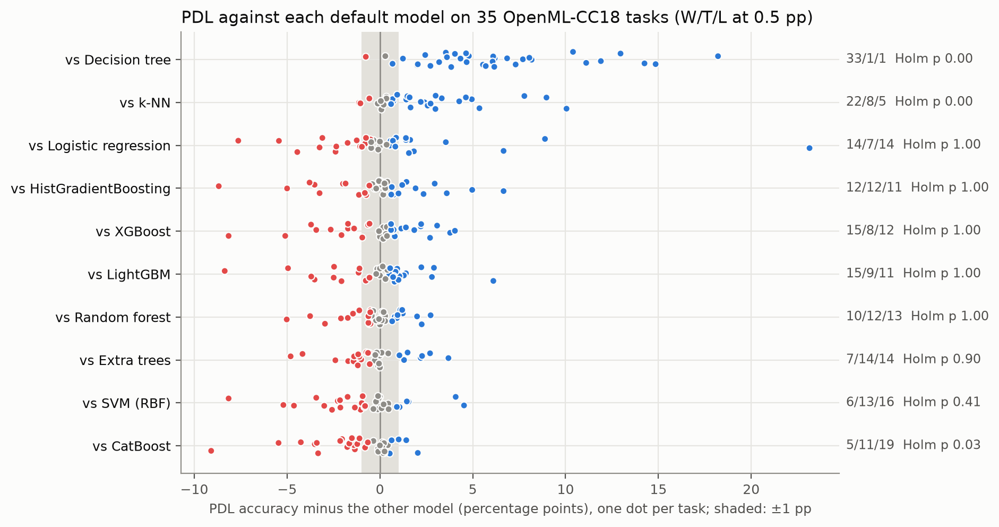
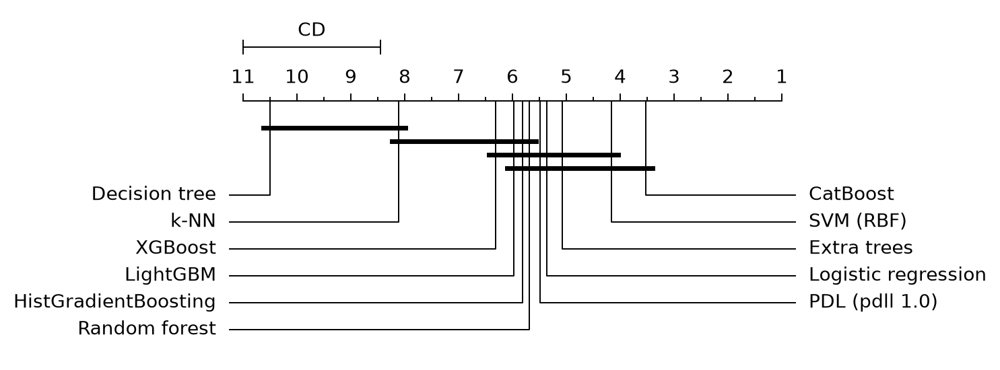
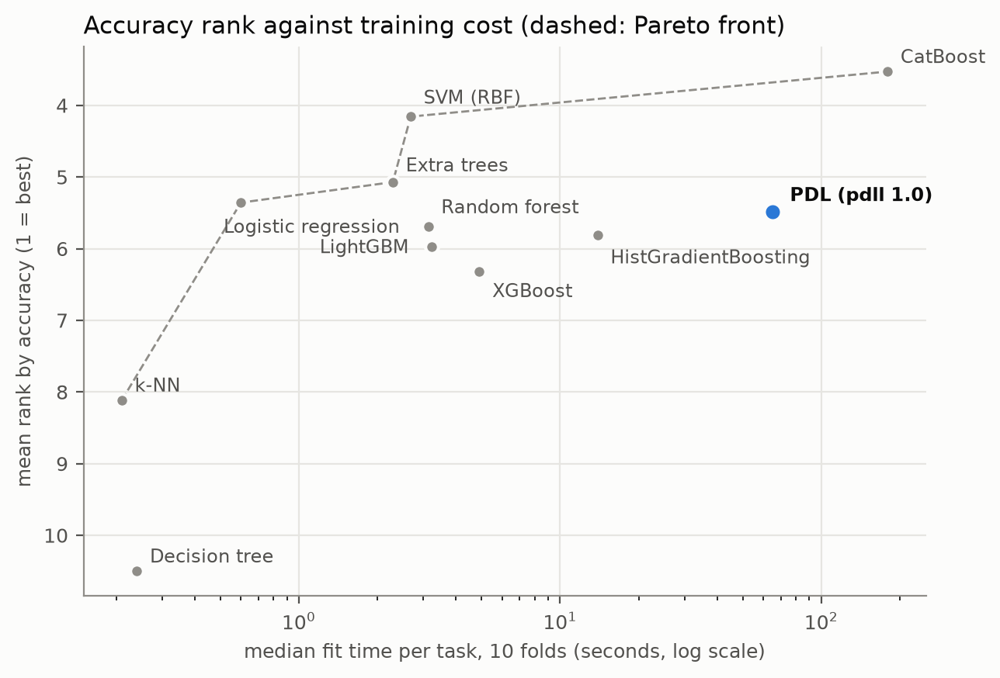
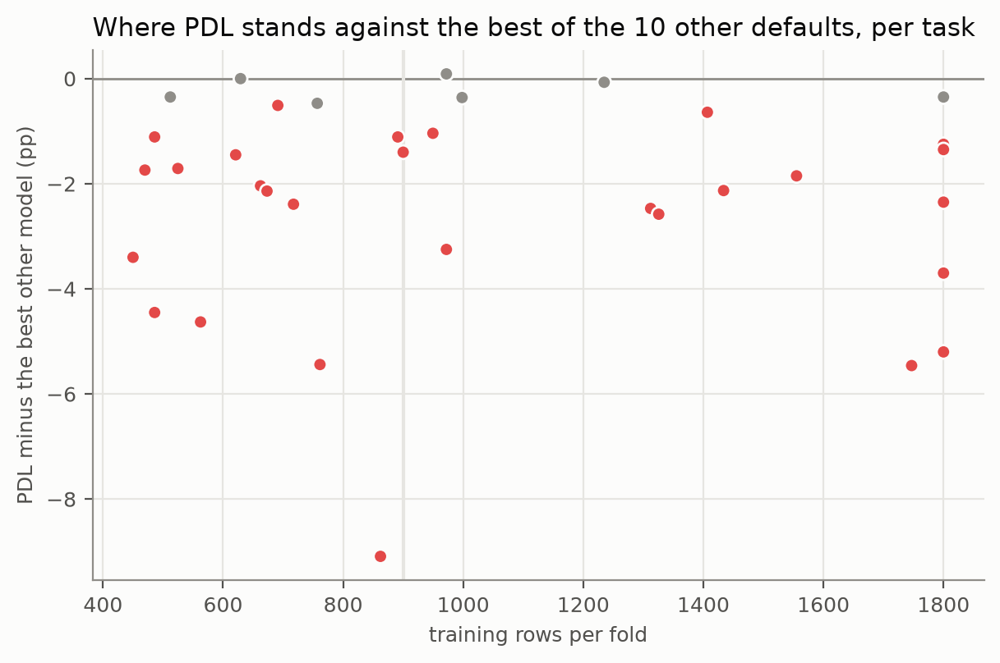

# Small-data benchmark: PDL against 10 default classifiers on 35 OpenML-CC18 tasks

**Scope of every number below: the 35 OpenML-CC18 tasks with 500–2,000 rows, every model with its default settings,
the official 10-fold split of each task, accuracy.** pdll 1.0.0 as released; protocol fixed in `6642b04` before any
result was read (deviations listed below).

- PDL ranks **5th of 11** by mean rank (5.49) and is in the **top group**: within the Nemenyi critical difference
  (2.55 ranks) of the best model, CatBoost (3.53), together with the SVM, extra trees, logistic regression, random
  forest, HistGradientBoosting and LightGBM.
- **CatBoost is more accurate than PDL** (−1.2 pp on average, 5 wins / 11 ties / 19 losses for PDL, Holm p = 0.035).
- PDL is **practically equivalent** to random forest and extra trees (within 1 pp, Bayesian signed-rank), **not
  practically worse** than LightGBM and XGBoost, and **more accurate** than k-NN (+2.0 pp) and a single decision tree
  (+6.1 pp). Against HistGradientBoosting the verdict is **borderline**: P(not practically worse) = 0.950, exactly at
  the declared 0.95 threshold (just below it in an unseeded run), so read it as inconclusive. Against logistic
  regression and the RBF SVM the data are inconclusive.
- **Robustness:** the equivalence with random forest and extra trees holds in every accuracy sensitivity analysis.
  The other verdicts are less stable: without the 9 tasks used to choose pdll's defaults, CatBoost's lead and the
  LightGBM verdict become inconclusive; with the six mfeat views averaged, so do CatBoost, HistGradientBoosting and
  XGBoost (see Sensitivity).
- **Cost:** PDL's median fit time is 65 s per task (10 folds), 28× extra trees and 20× LightGBM; its median predict
  time is 12 s. CatBoost, the most accurate, takes 179 s.
- **Other metrics:** by ROC AUC PDL ranks 3rd; by macro-F1 it ranks 9th, consistent with the earlier finding that
  PDL under-predicts minority classes by default (`benchmark/real_world`: there, PDL's own `class_weight="balanced"`
  parameter raised macro-F1 by up to 0.05 on 10 imbalanced datasets, on one split; that parameter defaults to `None`,
  is distinct from the base estimator's `class_weight="balanced"`, and was not used in this benchmark).
- **Declared outcome: B (middle).** With default settings on these 500–2,000-row tasks, training on pairs did not
  make PDL more accurate than its own base learner family (extra trees: practically equivalent). The paper's gains
  were measured with tuned learners on 100–600 rows; this benchmark does not test that setting.









## Protocol and deviations

| | |
|---|---|
| Tasks | The 35 OpenML-CC18 tasks with at most 2,000 rows (`run_all.py`, `CC18_SMALL`): 500–2,000 rows, 450–1,800 training rows per fold |
| Split | Each task's official 10-fold split (repeat 0), the split behind OpenML's public leaderboards |
| Models | PDL (pdll 1.0.0, `PairwiseDifferenceClassifier(random_state=0)`: ExtraTrees(class_weight="balanced"), `max_pairs="auto"`: 100,000 pairs, fewer on the three widest tasks (cnae-9 26,132, semeion 87,381, mfeat-pixel 93,206), at most 500 anchors), logistic regression, k-NN, SVM (RBF), decision tree, random forest, extra trees, HistGradientBoosting, LightGBM 4.7.0, XGBoost 3.4.1, CatBoost 1.2.10; scikit-learn 1.9.1, numpy 2.5.4, pandas 3.0.6, Python 3.12 |
| Settings | Defaults only, apart from `random_state=0`, thread counts, silenced logs, `max_iter=1000` (logistic regression) and `probability=True` (SVM); each model gets the raw DataFrame the way its documentation recommends (`models.py`) |
| Metric | Accuracy, the mean over the 10 folds; ROC AUC and macro-F1 as secondary metrics |
| Failure rule | A model without a result on a task gets the majority-class score there; no task is dropped |
| Analysis | Friedman + Nemenyi CD (autorank, non-parametric); PDL vs each model: wins/ties/losses with a 0.5 pp tie, Wilcoxon signed-rank (`zsplit`) with Holm over the 10 comparisons, Bayesian signed-rank with a ±1 pp ROPE; verdicts and the A/B/C outcome follow wording fixed before the results were read |
| Protocol commit | `6642b04` (2026-10-21 07:06). Harness fixes: `d369725` (parallel public-score download), `97b49de` (environment check) and `7c067c3` (retries, report fixes). Statistics script `d686117`, written before the published run; its verdict and outcome rules are unchanged since. Added with or after the results: the further sensitivity analyses and the figures (`b4374c9`) and a fixed seed for the Bayesian test (see deviation 6). No change to tasks, models or settings |
| Code of the published run | pdll 1.0.0 as released on PyPI (`227d249`) |
| Hardware | Intel Core i7-8750H (6 cores, 12 threads), 16 GB RAM, Windows 11; one run at a time, 12 threads per run |

## Deviations

1. **Two passes.** A first pass (`results/cc18_small_first_pass_contended.jsonl`) started 9 minutes before the
   protocol commit and ran 4 models at a time while other jobs used the same machine: its times are not usable and 10
   of its runs failed for lack of memory or time (CatBoost timeouts, memory errors). It also ran on pdll at `dbeb3fe`,
   before the 1.0.0 fixes. All published numbers come from a **second pass**: one run at a time, pdll 1.0.0 as
   released, started after the release. No accuracy of the first pass was used to change anything; it is kept to
   check that the deterministic models give the same accuracies in both passes.
2. **Timeout.** 5,400 s per (task, model) in the second pass instead of the default 1,800 s, so that CatBoost
   finishes on the categorical tasks (in the contended first pass it timed out at 2,700 s on 6 of the 8 categorical
   tasks it reached, ran out of memory on a 7th and finished only on ilpd).
3. **Not a quiet machine.** During the second pass the laptop was also in ordinary use (a browser, an Android
   emulator), and the pass was paused twice for an hour (interrupted runs were redone from scratch). Times are
   wall-clock and indicative; accuracies are not affected.
4. **Foundation models** (TabPFN, TabICL) were not part of the declared pool and were not run.
5. **Tuning overlap.** 9 of the 35 tasks were in the 20-dataset study that chose `max_pairs` and `max_anchors`, and
   2 more (ilpd, pc4) are named in `imbalance_probe.py`; the sensitivity analysis reports the results without them.
   Its second variant also leaves out diabetes, although the "diabetes" in the E2E gate is scikit-learn's 442-row
   regression dataset, not OpenML task 37.
6. **Seed of the Bayesian test.** baycomp samples its posterior. The first analysis was unseeded; the published
   numbers use `random_state=0`, fixed after the first run because one verdict (HistGradientBoosting,
   P(not practically worse) = 0.950) sits on the 0.95 threshold and flipped between runs. That verdict is reported
   as borderline; no other verdict depends on the seed.

## Consistency check between the two passes

The contended first pass (pdll at `dbeb3fe`, before the 1.0.0 fixes) and the published second pass (pdll 1.0.0)
share 206 (task, model) results: 204 have exactly the same accuracy, every PDL result included, so the 1.0.0 fixes
did not change PDL on these tasks. The two differences are k-NN on tic-tac-toe (0.915 vs 0.905) and XGBoost on
analcatdata_dmft (0.206 vs 0.205); the second pass is used throughout.

## Statistics

35 tasks x 11 models. Results imputed with the majority-class score: 0 of 385 {}

Friedman p = 4.9e-20; Nemenyi critical difference = 2.55 ranks; top group (within the CD of CatBoost): ['CatBoost', 'SVM (RBF)', 'Extra trees', 'Logistic regression', 'PDL (pdll 1.0)', 'Random forest', 'HistGradientBoosting', 'LightGBM']

| model                |   mean rank |   mean accuracy |   top-3 finishes |   median fit s |   median predict s |
|:---------------------|------------:|----------------:|-----------------:|---------------:|-------------------:|
| CatBoost             |       3.529 |           0.848 |           16.000 |        179.460 |              0.160 |
| SVM (RBF)            |       4.157 |           0.844 |           16.000 |          2.680 |              0.380 |
| Extra trees          |       5.071 |           0.839 |           13.000 |          2.290 |              0.990 |
| Logistic regression  |       5.357 |           0.831 |           13.000 |          0.600 |              0.150 |
| PDL (pdll 1.0)       |       5.486 |           0.836 |            9.000 |         65.140 |             12.460 |
| Random forest        |       5.686 |           0.838 |            9.000 |          3.130 |              0.960 |
| HistGradientBoosting |       5.814 |           0.837 |           10.000 |         13.920 |              0.550 |
| LightGBM             |       5.971 |           0.838 |            3.000 |          3.230 |              0.140 |
| XGBoost              |       6.314 |           0.837 |            6.000 |          4.910 |              0.320 |
| k-NN                 |       8.114 |           0.816 |            3.000 |          0.210 |              0.530 |
| Decision tree        |      10.500 |           0.775 |            0.000 |          0.240 |              0.090 | 

## PDL against each model

| model                |   wins |   ties |   losses |   mean_diff |   ci_low |   ci_high |   wilcoxon_p |   holm_p |   p_pdl |   p_rope |   p_other |   fit_ratio | verdict                                                              |
|:---------------------|-------:|-------:|---------:|------------:|---------:|----------:|-------------:|---------:|--------:|---------:|----------:|------------:|:---------------------------------------------------------------------|
| Logistic regression  |     14 |      7 |       14 |       0.005 |   -0.009 |     0.023 |        0.812 |    1.000 |   0.068 |    0.823 |     0.109 |     108.567 | inconclusive (95% interval of the mean difference: -0.009 to +0.023) |
| k-NN                 |     22 |      8 |        5 |       0.020 |    0.012 |     0.030 |        0.000 |    0.001 |   0.932 |    0.068 |     0.000 |     310.190 | more accurate than k-NN on these tasks                               |
| SVM (RBF)            |      6 |     13 |       16 |      -0.008 |   -0.016 |    -0.000 |        0.059 |    0.410 |   0.000 |    0.777 |     0.222 |      24.306 | inconclusive (95% interval of the mean difference: -0.016 to -0.000) |
| Decision tree        |     33 |      1 |        1 |       0.061 |    0.048 |     0.077 |        0.000 |    0.000 |   1.000 |    0.000 |     0.000 |     271.417 | more accurate than Decision tree on these tasks                      |
| Random forest        |     10 |     12 |       13 |      -0.002 |   -0.008 |     0.003 |        0.670 |    1.000 |   0.000 |    0.997 |     0.003 |      20.812 | practically equivalent to Random forest (within 1 pp)                |
| Extra trees          |      7 |     14 |       14 |      -0.002 |   -0.008 |     0.003 |        0.149 |    0.896 |   0.000 |    0.997 |     0.002 |      28.445 | practically equivalent to Extra trees (within 1 pp)                  |
| HistGradientBoosting |     12 |     12 |       11 |      -0.001 |   -0.010 |     0.008 |        0.831 |    1.000 |   0.033 |    0.917 |     0.050 |       4.680 | not practically worse than HistGradientBoosting                      |
| LightGBM             |     15 |      9 |       11 |      -0.002 |   -0.010 |     0.006 |        0.756 |    1.000 |   0.008 |    0.947 |     0.045 |      20.167 | not practically worse than LightGBM                                  |
| XGBoost              |     15 |      8 |       12 |      -0.001 |   -0.010 |     0.007 |        0.606 |    1.000 |   0.042 |    0.914 |     0.044 |      13.267 | not practically worse than XGBoost                                   |
| CatBoost             |      5 |     11 |       19 |      -0.012 |   -0.020 |    -0.005 |        0.004 |    0.035 |   0.000 |    0.596 |     0.404 |       0.363 | CatBoost is more accurate than PDL                                   | 

**Declared outcome: B (middle)** (PDL mean-rank place 5 of 11).

## Where PDL stands by size

- up to 1,000 rows (18 tasks): PDL mean rank 5.47 (place 4), mean gap to the best other model -2.4 pp
- 1,001 to 2,000 rows (17 tasks): PDL mean rank 5.50 (place 4), mean gap to the best other model -2.0 pp

## Sensitivity

- Without the 9 tasks of the defaults study (26 tasks): PDL mean rank 5.60 (place 5); against ExtraTrees: 4/10/12, Holm p 0.573, practically equivalent to Extra trees (within 1 pp). Verdicts that change: LightGBM: not practically worse than LightGBM -> inconclusive; CatBoost: CatBoost is more accurate than PDL -> inconclusive
- Also without diabetes, ilpd, pc4 (23 tasks): PDL mean rank 5.67 (place 5); against ExtraTrees: 3/10/10, Holm p 0.489, practically equivalent to Extra trees (within 1 pp). Verdicts that change: k-NN: more accurate than k-NN on these tasks -> not practically worse than k-NN; LightGBM: not practically worse than LightGBM -> inconclusive; CatBoost: CatBoost is more accurate than PDL -> inconclusive
- mfeat views averaged into one task (30 tasks): PDL mean rank 5.47 (place 5); against ExtraTrees: 6/12/12, Holm p 1.000, practically equivalent to Extra trees (within 1 pp). Verdicts that change: HistGradientBoosting: not practically worse than HistGradientBoosting -> inconclusive; XGBoost: not practically worse than XGBoost -> inconclusive; CatBoost: CatBoost is more accurate than PDL -> inconclusive
- roc_auc instead of accuracy (35 tasks): PDL mean rank 5.07 (place 3); against ExtraTrees: 14/18/3, Holm p 0.598, not practically worse than Extra trees. Verdicts that change: Logistic regression: inconclusive -> practically equivalent to Logistic regression (within 1 pp); SVM (RBF): inconclusive -> practically equivalent to SVM (RBF) (within 1 pp); Extra trees: practically equivalent to Extra trees (within 1 pp) -> not practically worse than Extra trees; HistGradientBoosting: not practically worse than HistGradientBoosting -> practically equivalent to HistGradientBoosting (within 1 pp); LightGBM: not practically worse than LightGBM -> practically equivalent to LightGBM (within 1 pp); XGBoost: not practically worse than XGBoost -> practically equivalent to XGBoost (within 1 pp); CatBoost: CatBoost is more accurate than PDL -> practically equivalent to CatBoost (within 1 pp)
- macro_f1 instead of accuracy (35 tasks): PDL mean rank 6.39 (place 9); against ExtraTrees: 7/10/18, Holm p 0.157, inconclusive (95% interval of the mean difference: -0.025 to -0.005). Verdicts that change: k-NN: more accurate than k-NN on these tasks -> not practically worse than k-NN; Random forest: practically equivalent to Random forest (within 1 pp) -> inconclusive; Extra trees: practically equivalent to Extra trees (within 1 pp) -> inconclusive; HistGradientBoosting: not practically worse than HistGradientBoosting -> inconclusive; LightGBM: not practically worse than LightGBM -> inconclusive; XGBoost: not practically worse than XGBoost -> inconclusive
- Wins/ties/losses with a tie threshold of 0 pp: {'Logistic regression': '15/1/19', 'k-NN': '29/0/6', 'SVM (RBF)': '12/1/22', 'Decision tree': '34/0/1', 'Random forest': '16/1/18', 'Extra trees': '10/4/21', 'HistGradientBoosting': '19/1/15', 'LightGBM': '19/2/14', 'XGBoost': '21/1/13', 'CatBoost': '12/1/22'}
- Wins/ties/losses with a tie threshold of 1 pp: {'Logistic regression': '9/16/10', 'k-NN': '18/13/4', 'SVM (RBF)': '5/18/12', 'Decision tree': '32/3/0', 'Random forest': '6/22/7', 'Extra trees': '7/18/10', 'HistGradientBoosting': '8/19/8', 'LightGBM': '7/19/9', 'XGBoost': '9/17/9', 'CatBoost': '3/16/16'}

## Per-task results

The public rank counts the OpenML methods (flow names without version suffix) whose best public run on the same
task and split beats PDL by more than 0.0005. It is a harsh reference: public runs include tuned pipelines and
AutoML systems, while every model here runs with defaults. Ranks are missing for 14 tasks because the OpenML
server was down when the results came in; `python public_rank.py results/cc18_small.jsonl` fills them in.

### Accuracy per task (10-fold, official OpenML split)

|   task | dataset                          |   rows |   PDL (pdll 1.0) |   Logistic regression |   k-NN |   SVM (RBF) |   Decision tree |   Random forest |   Extra trees |   HistGradientBoosting |   LightGBM |   XGBoost |   CatBoost | PDL rank among public OpenML methods   |   best public |
|-------:|:---------------------------------|-------:|-----------------:|----------------------:|-------:|------------:|----------------:|----------------:|--------------:|-----------------------:|-----------:|----------:|-----------:|:---------------------------------------|--------------:|
| 125920 | dresses-sales                    |    500 |            0.582 |                 0.590 |  0.558 |       0.612 |           0.562 |           0.562 |         0.560 |                  0.546 |      0.568 |     0.560 |      0.616 | 85                                     |         0.658 |
|   3913 | kc2                              |    522 |            0.828 |                 0.845 |  0.833 |       0.837 |           0.780 |           0.845 |         0.828 |                  0.826 |      0.839 |     0.845 |      0.841 | 220                                    |         0.870 |
|  14954 | cylinder-bands                   |    540 |            0.832 |                 0.743 |  0.754 |       0.791 |           0.720 |           0.843 |         0.833 |                  0.839 |      0.822 |     0.809 |      0.811 | 8                                      |         0.859 |
| 146819 | climate-model-simulation-crashes |    540 |            0.915 |                 0.959 |  0.926 |       0.924 |           0.894 |           0.920 |         0.920 |                  0.950 |      0.950 |     0.952 |      0.948 | 43                                     |         0.967 |
|   9946 | wdbc                             |    569 |            0.972 |                 0.975 |  0.968 |       0.974 |           0.931 |           0.960 |         0.974 |                  0.970 |      0.972 |     0.970 |      0.975 | 44                                     |         0.984 |
|   9971 | ilpd                             |    583 |            0.727 |                 0.728 |  0.678 |       0.712 |           0.665 |           0.700 |         0.744 |                  0.678 |      0.698 |     0.697 |      0.717 | 21                                     |         0.743 |
|     11 | balance-scale                    |    625 |            0.856 |                 0.861 |  0.830 |       0.902 |           0.774 |           0.834 |         0.819 |                  0.854 |      0.877 |     0.877 |      0.891 | 279                                    |         1.000 |
|     29 | credit-approval                  |    690 |            0.868 |                 0.859 |  0.835 |       0.854 |           0.822 |           0.883 |         0.875 |                  0.871 |      0.870 |     0.868 |      0.867 | 51                                     |         0.888 |
|     15 | breast-w                         |    699 |            0.971 |                 0.966 |  0.969 |       0.967 |           0.944 |           0.971 |         0.971 |                  0.957 |      0.959 |     0.960 |      0.967 | 26                                     |         0.977 |
|   2079 | eucalyptus                       |    736 |            0.675 |                 0.670 |  0.575 |       0.672 |           0.614 |           0.674 |         0.678 |                  0.679 |      0.676 |     0.668 |      0.696 | 29                                     |         0.700 |
|  10101 | blood-transfusion-service-center |    748 |            0.761 |                 0.771 |  0.771 |       0.778 |           0.714 |           0.753 |         0.738 |                  0.757 |      0.753 |     0.753 |      0.782 | >= 249                                 |         0.807 |
|     37 | diabetes                         |    768 |            0.772 |                 0.777 |  0.742 |       0.762 |           0.699 |           0.777 |         0.759 |                  0.749 |      0.762 |     0.734 |      0.767 | 105                                    |         0.788 |
|   3560 | analcatdata_dmft                 |    797 |            0.198 |                 0.222 |  0.209 |       0.221 |           0.206 |           0.203 |         0.208 |                  0.209 |      0.206 |     0.205 |      0.192 | 205                                    |         0.263 |
|   3549 | analcatdata_authorship           |    841 |            0.994 |                 0.999 |  0.995 |       0.995 |           0.933 |           0.993 |         0.994 |                  0.987 |      0.986 |     0.989 |      0.992 | 81                                     |         0.999 |
|     53 | vehicle                          |    846 |            0.735 |                 0.790 |  0.708 |       0.769 |           0.703 |           0.765 |         0.749 |                  0.773 |      0.760 |     0.769 |      0.778 | 166                                    |         0.870 |
|     49 | tic-tac-toe                      |    958 |            0.907 |                 0.983 |  0.905 |       0.989 |           0.872 |           0.957 |         0.955 |                  0.994 |      0.991 |     0.989 |      0.998 | 303                                    |         1.000 |
|   3022 | vowel                            |    990 |            0.976 |                 0.744 |  0.922 |       0.967 |           0.827 |           0.967 |         0.987 |                  0.957 |      0.954 |     0.935 |      0.962 | 43                                     |         0.998 |
|     31 | credit-g                         |   1000 |            0.765 |                 0.758 |  0.735 |       0.765 |           0.688 |           0.754 |         0.738 |                  0.755 |      0.755 |     0.758 |      0.779 | >= 58                                  |         0.786 |
|   9957 | qsar-biodeg                      |   1055 |            0.869 |                 0.870 |  0.855 |       0.880 |           0.808 |           0.866 |         0.870 |                  0.875 |      0.869 |     0.879 |      0.870 | 59                                     |         0.894 |
| 146800 | MiceProtein                      |   1080 |            0.997 |                 0.989 |  0.982 |       0.996 |           0.868 |           0.994 |         0.996 |                  0.985 |      0.990 |     0.979 |      0.995 | 15                                     |         1.000 |
|   9981 | cnae-9                           |   1080 |            0.919 |                 0.952 |  0.873 |       0.874 |           0.864 |           0.920 |         0.933 |                  0.853 |      0.858 |     0.925 |      0.937 | 137                                    |         0.966 |
|   3918 | pc1                              |   1109 |            0.933 |                 0.930 |  0.926 |       0.929 |           0.909 |           0.937 |         0.932 |                  0.931 |      0.929 |     0.931 |      0.934 |                                        |       nan     |
|  10093 | banknote-authentication          |   1372 |            0.999 |                 0.981 |  0.999 |       1.000 |           0.987 |           0.993 |         0.999 |                  0.996 |      0.994 |     0.996 |      0.997 |                                        |       nan     |
|   3902 | pc4                              |   1458 |            0.896 |                 0.906 |  0.890 |       0.905 |           0.890 |           0.903 |         0.908 |                  0.916 |      0.921 |     0.914 |      0.913 |                                        |       nan     |
|     23 | cmc                              |   1473 |            0.524 |                 0.508 |  0.481 |       0.550 |           0.481 |           0.526 |         0.509 |                  0.518 |      0.520 |     0.517 |      0.536 |                                        |       nan     |
|   3903 | pc3                              |   1563 |            0.900 |                 0.900 |  0.884 |       0.898 |           0.861 |           0.904 |         0.906 |                  0.893 |      0.892 |     0.896 |      0.898 |                                        |       nan     |
|   9964 | semeion                          |   1593 |            0.933 |                 0.917 |  0.911 |       0.955 |           0.751 |           0.940 |         0.945 |                  0.942 |      0.939 |     0.930 |      0.949 |                                        |       nan     |
| 146821 | car                              |   1728 |            0.979 |                 0.913 |  0.889 |       0.975 |           0.976 |           0.984 |         0.981 |                  0.998 |      0.990 |     0.993 |      0.990 |                                        |       nan     |
| 146817 | steel-plates-fault               |   1941 |            0.753 |                 0.718 |  0.744 |       0.755 |           0.717 |           0.791 |         0.795 |                  0.803 |      0.803 |     0.804 |      0.808 |                                        |       nan     |
|     16 | mfeat-karhunen                   |   2000 |            0.963 |                 0.949 |  0.957 |       0.976 |           0.820 |           0.961 |         0.968 |                  0.963 |      0.961 |     0.957 |      0.971 |                                        |       nan     |
|     22 | mfeat-zernike                    |   2000 |            0.784 |                 0.816 |  0.795 |       0.837 |           0.665 |           0.772 |         0.780 |                  0.786 |      0.781 |     0.785 |      0.791 |                                        |       nan     |
|     14 | mfeat-fourier                    |   2000 |            0.815 |                 0.823 |  0.798 |       0.837 |           0.758 |           0.836 |         0.839 |                  0.848 |      0.852 |     0.842 |      0.849 |                                        |       nan     |
|     12 | mfeat-factors                    |   2000 |            0.968 |                 0.981 |  0.966 |       0.976 |           0.887 |           0.967 |         0.971 |                  0.968 |      0.970 |     0.962 |      0.975 |                                        |       nan     |
|     18 | mfeat-morphological              |   2000 |            0.716 |                 0.739 |  0.712 |       0.717 |           0.647 |           0.706 |         0.705 |                  0.686 |      0.688 |     0.689 |      0.713 |                                        |       nan     |
| 146824 | mfeat-pixel                      |   2000 |            0.978 |                 0.964 |  0.977 |       0.981 |           0.874 |           0.978 |         0.978 |                  0.975 |      0.972 |     0.964 |      0.978 |                                        |       nan     |

## Reproduce

```shell
pip install -e . -r benchmark/small_data/requirements.txt autorank==1.3.0 baycomp==1.0.3
cd benchmark/small_data
python run_all.py --out results/cc18_small.jsonl --workers 1 --n-jobs 12 --timeout 5400   # several hours on a laptop
python public_rank.py results/cc18_small.jsonl                                            # needs openml.org
python report.py results/cc18_small.jsonl results/openml_public.json > report.md
python analyze.py results/cc18_small.jsonl --figures figures > ANALYSIS.md
```
